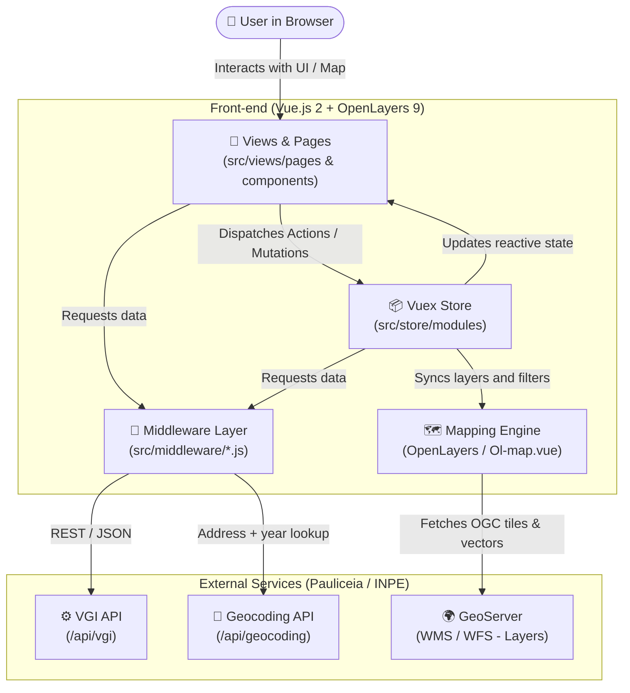

# Architecture & Project Structure — Pauliceia 2.0 (Front-end)

This document provides an overview of the architecture, directory structure, and data flow of the **Pauliceia 2.0** web front-end portal.

---

## 🏗️ Tech Stack Overview

The application is a **Single Page Application (SPA)** built on the Vue.js ecosystem alongside specialized WebGIS tools:

| Layer                    | Technology                            | Version   | Role in the Application                                                   |
| :----------------------- | :------------------------------------ | :-------- | :------------------------------------------------------------------------ |
| **UI Framework**         | Vue.js                                | `^2.7.16` | Reactive rendering of components and pages                                |
| **State Management**     | Vuex                                  | `^3.6.2`  | Global state (authentication, active layers, map edits)                   |
| **Routing**              | Vue Router                            | `^3.6.5`  | SPA navigation across interactive map, dashboard, and institutional pages |
| **Mapping Engine**       | OpenLayers (`ol`)                     | `^9.2.4`  | Map rendering, vector/raster layers, projections, and features            |
| **HTTP Client**          | Axios                                 | `^1.7.7`  | Asynchronous communication with VGI API, Geocoding API, and GeoServer     |
| **Internationalization** | Vue I18n / Vuex I18n                  | `^8.28.2` | Multilingual support (Portuguese and English)                             |
| **UI Components**        | Element UI, Vue Material, Bootstrap 5 | —         | Modals, tables, forms, sidebars, and UI controls                          |
| **Bundler**              | Webpack                               | `^5.94.0` | Build, minification, hot-reload, and prerendering                         |

---

## 📂 Directory Structure

```text
pauliceia/
├── build/                  # Build scripts and Webpack configuration (dev and prod)
├── config/                 # Environment variables and external service URLs (prod.env.js)
├── docs/                   # Technical documentation for this repository
├── src/                    # Main application source code
│   ├── middleware/         # HTTP service layer and external API integrations
│   ├── router/             # Route definitions and navigation guards
│   ├── store/              # Centralized Vuex state (modules and persistence)
│   ├── views/              # Presentation layer (components, pages, layouts, and i18n)
│   ├── App.vue             # Root application component
│   └── main.js             # Entry point (Vue bootstrap, plugins, and global OpenLayers)
├── static/                 # Public static assets served directly
├── .editorconfig           # Editor formatting standardization
├── eslint.config.js        # Static analysis and linting rules (ESLint 9)
└── package.json            # Dependencies manifest and NPM scripts
```

---

## 🧩 Module Breakdown (`src/`)

### 1. `src/middleware/` — API & Geographic Service Layer

Centralizes all external HTTP calls using `axios`, decoupling network logic from UI components:

- **`ApiVGI.js`**: Client instance and endpoints for the Volunteered Geographic Information (VGI) API (layers, users, attributes, and collaborative data).
- **`ApiGeocoding.js`**: Integration with the historical geocoding engine (searching historical São Paulo addresses by street name, number, and year).
- **`Map.js`**: Requests related to querying and handling geographic layers and features.
- **`Edit.js`**: Create, update, and delete operations for vector geometries on collaborative layers.
- **`Dashboard.js`**: Support services for the user dashboard (CSV/Shapefile uploads, layer metadata, keywords).
- **`User.js`**: Authentication, registration, profile, and email/social validation.

### 2. `src/store/` — State Management (Vuex)

Manages state shared across multiple UI components (map sidebar, timeline slider, OpenLayers canvas), with local persistence via `vuex-persistedstate`:

- **`modules/auth.js`**: Authenticated user session, tokens, and permissions.
- **`modules/map.js`**: Visible layers, opacity, temporal filtering (year slider), geocoding, and feature popups.
- **`modules/edit.js`**: Active drawing and vector editing tools on the map.
- **`modules/dashboard.js` & `modules/dashboardNewLayer.js`**: State for layer creation and management workflows in the contributor dashboard.

### 3. `src/router/` — Routing (Vue Router)

Splits application routes by context:

- **`map.js`**: Main map exploration route (`/explore`).
- **`dashboard.js`**: Authenticated contributor dashboard routes (layer management, new layer creation, profile).
- **`routes.js` & `index.js`**: Institutional pages (`/home`, `/about`, `/tutorial`, `/contact`, `/login`, `/register`) and router setup.

### 4. `src/views/` — User Interface & Localization

- **`layouts/`**: Base page layouts (`application.vue` for the main portal/map and `dashboard.vue` for the authenticated user area).
- **`pages/`**: Route-level page components (`home.vue`, `explore.vue`, `about.vue`, `tutorial.vue`, `login.vue`, etc.).
- **`components/`**:
  - `map/`: Geographic components wired to OpenLayers (`Ol-map.vue`, `Timeline.vue`, layer controls, legend, address search, and geocoding).
  - `aside-right/`: Collapsible right-hand panels for attributes, layers, and tools.
  - `dashboard/`: Forms and tables for the contributor dashboard.
- **`language/`**: Translation dictionaries (`translations/`) supporting Portuguese and English.

---

## 🔄 Data Flow & Interaction Architecture

The diagram below illustrates how a user action (such as searching for a historical address or toggling a temporal layer) flows through the front-end architecture to backend services:



---

## ⚙️ Service Configuration (`config/`)

Front-end connections to backend services are configured in `config/prod.env.js` (copied from `config/prod.env.js.EXAMPLE`):

- `urlVGI`: Base endpoint for the collaborative data REST API (VGI).
- `urlGeocoding`: Endpoint for the historical geocoding API.
- `urlGeoserverPauliceia`: Primary GeoServer workspace serving official and collaborative historical layers.
- `urlGeoserveOther`: Secondary GeoServer workspace for auxiliary layers.
- `keyCripto`: Client-side key used for hash/verification routines.
